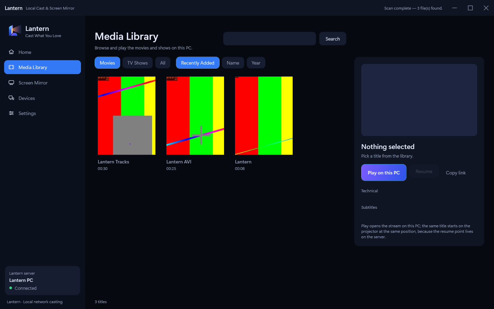
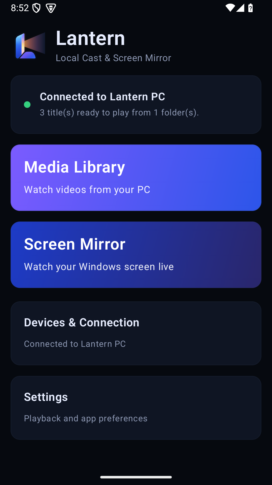

# Lantern

Share your Windows screen and sound with an Android TV, projector, or phone. Or browse and play videos stored on your PC. Lantern streams over your home network and needs no account.

**[Download for Windows](https://github.com/divya-abhishek/Lantern/releases/download/v1.0.0/Lantern-win-x64.zip)** · **[Download for Android](https://github.com/divya-abhishek/Lantern/releases/download/v1.0.0/Lantern-Android.apk)** · [Release notes](https://github.com/divya-abhishek/Lantern/releases/tag/v1.0.0)

## Get started

1. **On Windows 10 or 11 (64-bit):** Extract the ZIP to a folder such as Documents → Lantern. Open **Set up Lantern**. It downloads the streaming tools once and asks Windows to allow Lantern on private networks. After setup, open **Lantern.Desktop.exe** to start the app.
2. **On Android 7 or later:** Install the APK and open Lantern. On a projector or TV, transfer the APK and open it with the device's file manager. Android may ask you to allow installation from that app.
3. **Connect:** Put both devices on the same trusted home network. In Windows Lantern, open **Devices**, choose your receiver, and click **Connect**. Select **Yes** on the receiver. If discovery is unavailable, open **Devices** on Android, enter the address shown on the PC, and type the receiver's four-digit code on Windows.

## Watch something

- **Share your screen:** Choose **Screen Mirror → Start mirroring** on Windows. On Android, choose **Screen Mirror → Start receiving**. PC sound is on by default. Start with 720p at 30 FPS, then raise resolution or frame rate if playback is smooth.
- **Play your videos:** In Windows Lantern, add a folder in **Settings**. Open **Media Library** on Android and pick a video. Some files need time to prepare the first time. Open **Audio / Subtitles** during playback to choose a track.

If the receiver cannot find the PC, keep Lantern open, check that Windows marks your home network **Private**, and rerun **Set up Lantern**. Guest networks may block devices from seeing each other. Some protected video services can block screen capture.

## Screenshots

| Windows media library with sample videos | Android home |
| --- | --- |
|  |  |

## Build and verification

See [build instructions](docs/BUILD.md) and [release notes](docs/RELEASE-NOTES.md).
